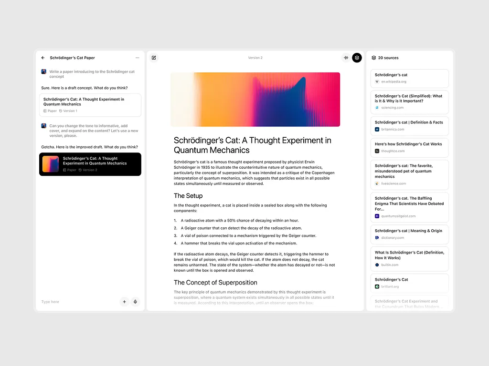

# Studio — minimal workspace design

**Status:** Typography and the first spacing/composer-sizing pass are implemented;
the three-panel layout and theme changes remain proposed.
**Date:** 2026-11-12
**Working branch:** `codex/minimal-workspace`, created from `design/family-a`
at `6ac47e84` after the user chose to preserve its fixes and features.
**Reference:** User-supplied `1604.webp`, reproduced below. Its visible product
content is reference imagery, not a specification for Studio's capabilities.



## 1. Direction

Studio should feel like a quiet working surface: precise typography, three
well-proportioned sheets, neutral controls and content given most of the room.
Premium comes from alignment, measured whitespace, legible hierarchy and reliable
interaction. A document, photograph or map can provide color; the application
around it stays calm.

The reference is the starting point for the shell, density and restraint. Studio
still needs its actual capabilities: conversation history, projects, models,
reasoning, voice, permissions, files, browser/computer work and settings. Each
gets a deliberate place in this system before implementation begins.

The target direction is:

- Inter for interface and prose; JetBrains Mono for code and technical values.
- A 14px conversation/composer size, 13px interface labels and 12px metadata.
- A white light theme and a neutral charcoal dark theme.
- Three working panels: conversation on the left, viewer in the center,
  workspace on the right. Panels appear when their content is useful.
- A modest translucent outer rim, 6px panel seams and restrained corners.
- A composer showing text, Add and microphone at rest. Send replaces the
  microphone when a draft exists. Conversation controls live in the header.
- Compact is a deliberate single-panel composition with temporary overlays.
  Standard gives the three panels independent space.

All numerical values below are proposed logical CSS pixels at 100% interface
scale unless explicitly identified as measurements of the reference image.

## 2. What the reference actually establishes

### 2.1 Measurements and confidence

The supplied raster is **1024 × 768 pixels**. The application occupies about
884 × 556 pixels within it. The gray outside the application is presentation
background; it is not evidence that the application itself has a gray desktop.

| Element | Approximate position/size in supplied image | Interpretation |
| --- | --- | --- |
| Outer application | x 70–954, y 102–658 | A compactly framed object with a fine pale rim |
| Conversation sheet | x 75–303; about 228px wide | About 26% of usable panel width |
| Center viewer | x 307–762; about 455px wide | About 52% of usable panel width |
| Sources sheet | x 766–950; about 184px wide | About 21% of usable panel width |
| Inter-panel seams | About 4–5px | Ground visible between sheets rather than heavy dividers |
| Header band | About 30px high | Small, aligned controls; little permanent toolbar |
| Viewer text measure | About 345–350px | Generous side margins inside a wider sheet |
| Cover | About 355 × 114px | Wide media, quiet corners, no decorative surrounding card |
| Conversation body | Roughly 8–9px nominal visual text size | Reduced presentation; exact original CSS size unknown |
| Source title/metadata | Roughly 8px / 7px | Dense but differentiated primarily by weight and tone |
| Viewer title | Roughly 18px | Regular/medium sans, two lines, restrained tracking |
| Viewer section heading | Roughly 14px | Clear jump from body without heavy weight |
| Panel corners | Roughly 7–9px radius | Much quieter than oversized rounded cards |

Positions are manual visual estimates, not recovered source measurements. Body
font size cannot be determined from glyph height alone. The image does not
establish device pixel ratio, original window dimensions, browser zoom or export
scaling. Inter, SF Pro and similar neo-grotesque faces could all resemble it at
this resolution; **the exact font is unverified**.

For scale intuition only, enlarging the pictured application from 884px to
1440px wide is a factor of about 1.63. An apparent 8–9px text size would then
occupy about 13–15px. This motivates the 14px proposal; it does not prove the
original used 14px.

### 2.2 Sampled colors versus inferred treatment

Pixel sampling of large, mostly flat areas gives:

| Sample | Raster value | What carries over |
| --- | --- | --- |
| Presentation backdrop | `#E8E8E8` | A neutral context for evaluating the window |
| Panel interiors | Predominantly `#FFFFFF` | Clean, opaque reading surfaces |
| Pale upper rim | Approximately `#EFEFEF` | A soft boundary around the assembly |
| Selected artifact card | Predominantly `#000000` | Strong neutral selection is the main UI accent |
| Colored cover | Orange, pink and deep blue | Color belongs to the artifact, not every control |

The rim looks translucent, but a flattened image cannot establish actual alpha,
backdrop blur or OS material. Implement the appearance with explicit layers and
verify it against actual desktops. Do not describe it as recovered native glass.

There is no complete dark-mode reference. The selected black artifact card is
the cue for the proposed dark palette, not evidence of an existing dark screen.

### 2.3 Layout lessons

The viewer is the primary reading surface while an artifact is open. The chat
can be comparatively narrow because it supplies instructions and context. The
right panel supports the current work with sources or related material. Its
cards repeat one simple pattern.

The open reference does not show chat-only mode, Settings, navigation, model
controls, errors or dialogs. Sections below are explicit Studio proposals for
those unseen states, rather than claims about the reference application.

## 3. Information architecture

### 3.1 The three working panels

| Panel | Purpose | Persistent contents | Primary actions |
| --- | --- | --- | --- |
| Conversation | Talk to Studio and understand its work | Transcript, draft, current work summary | Send, Stop, answer approval, open an output |
| Viewer | Read or inspect one selected object | Document, file, diff, media, table, source or browser view | Close, switch open object, copy/download when supported |
| Workspace | Navigate the current conversation's supporting material | Activity, files, sources and outputs | Select an object, inspect work, stop a supported running task |

The conversation is the main interaction panel. The viewer becomes the visual
center of gravity when open. Workspace is contextual navigation, not a second
conversation and not another place to edit the draft.

Opening a workspace item selects its object in the center viewer. Opening a
source from a document does the same. A file's detailed inspector occupies the
viewer; it never creates a fourth permanent column.

### 3.2 Navigation without a fourth column

The upper-left navigation button opens a temporary history drawer containing
New chat, search, projects and recent conversations, with Settings at the bottom.
On standard windows it overlays the left area; on compact windows it occupies
up to 320px with a dismissible scrim. Selecting a destination closes it.

Navigation is keyboard reachable, has a visible trigger and retains the existing
Ctrl/Cmd+B shortcut. It is not an unlabeled hover strip at the screen edge.
Existing Ctrl/Cmd+K search, Ctrl/Cmd+N new chat and Ctrl/Cmd+, Settings retain
their meanings. Platform/browser shortcut conflicts must be tested before adding
new global combinations.

Home and Project are destinations in the main surface. Settings temporarily
uses the left panel for its section tree and the remaining surface for the
selected settings page. The conversation layout is restored on exit.

## 4. Window, layout and responsive behavior

### 4.1 Geometry tokens

| Token | Proposed value | Use |
| --- | --- | --- |
| Standard visible shell | 1440 × 900 | Preferred wide workspace, constrained by monitor work area |
| Compact visible shell | 720 × 845 | Preferred focused conversation window |
| Transparent desktop margin | 16px per side | Space outside the visible shell for its shadow |
| Visible shell rim | 4px | Translucent perimeter inside the shell bounds |
| Panel seam | 6px | Between working sheets |
| Outer corner radius | 16px | Visible shell |
| Working panel radius | 12px | Conversation, viewer, workspace |
| Card / field radius | 8px | Artifact, source, input and menu items |
| Small preview radius | 5px | Thumbnail inside a card |
| Header height | 44px | One aligned band across the panels |
| Standard panel padding | 16px | Conversation and workspace horizontal inset |
| Compact page padding | 24px; 16px below 480px | Single-panel transcript |
| Viewer page inset | 40px preferred; 24px minimum | Around document content |
| Small spacing scale | 4, 8, 12, 16, 24, 32, 40, 48px | Layout rhythm |

At 100% scale, native OS bounds add 32px to the visible shell dimensions. The
standard example is therefore 1472 × 932 before work-area fitting. These are
proposed presets, not changes already made to window sizing.

The transparent desktop margin stays a physical presentation allowance as UI
scale changes, following the existing native frame strategy. Browser-hosted
Studio fills its viewport and omits the desktop margin and outer glass rim.
Maximized native windows also remove the margin and square screen-edge corners.

If a monitor cannot fit a preset, constrain the native window to the work area
and let the responsive layout choose a composition. Do not apply a CSS transform
that shrinks the interface to make the standard screenshot fit.

### 4.2 Standard: all panels open

At a 1440px visible shell, subtract 8px rim and two 6px seams, leaving 1420px:

```text
4   Conversation 360   6       Viewer 756       6   Workspace 304   4
|-------------------|   |----------------------|   |--------------|
| title + controls  |   | object title/actions |   | Workspace v  |
|                   |   |                      |   |              |
| transcript        |   | selected content     |   | activity     |
|                   |   |                      |   | files        |
| work summary      |   |                      |   | sources      |
| composer          |   |                      |   | outputs      |
|-------------------|   |----------------------|   |--------------|
```

Chat resizes from 320–440px and workspace from 256–360px. The viewer takes the
remaining width, with a 480px floor for a three-panel composition. Splitter hit
areas span 8px around the quiet seam; visual lines appear on hover/focus only.
Splitters support keyboard resizing and cannot shrink a neighbor below its floor.
Remember widths per layout preference, within current available bounds.

Each panel has its own scroll container and fixed header. The conversation's
composer stays inside its panel. Viewer scrolling does not move chat, and source
scrolling does not move the document. Header dividers are omitted at rest; a
subtle separator can appear after that panel scrolls.

### 4.3 Panel combinations

| State | Standard composition | Reading measure / behavior |
| --- | --- | --- |
| Chat only | One sheet fills the shell | Transcript max 680px, composer max 680px, centered |
| Chat + viewer | Chat 360px; viewer fills remainder | Viewer document max 680px; no empty workspace reserved |
| Chat + workspace | Workspace 304px; chat fills remainder | Chat retains max 680px reading measure |
| All three | 360 / flexible / 304px | Reference-like hierarchy; chat text keeps 14px size |
| Viewer focus | Selected viewer fills the shell | Visible Back to chat; draft and chat state retained |

Chat-only is intentionally spacious. Do not enlarge body text when panels close,
or shrink it when they open. Its paragraph wrapping and margins adapt instead.

### 4.4 Responsive thresholds

Use the shell's actual available layout width after the rim and user interface
scale, not the monitor's physical pixel count. Content at 125% scale reaches
these constraints earlier. Browser zoom and text enlargement also need testing.

| Available width | Composition rule |
| --- | --- |
| 1120px and above | Up to three resident working panels |
| 800–1119px | Up to two resident panels; workspace is a temporary right sheet |
| Below 800px | One resident panel; viewer and workspace are full-panel overlays |
| Below 480px | 16px page inset, wrapping controls, touch-sized actions |

Thresholds are conservative above the three-panel minima. A user-resized panel
may require collapse before the nominal threshold. Restore the user's previous
panel choices when room returns; do not oscillate between states while dragging.
At a boundary, keep about 24px hysteresis before restoring a collapsed panel.

### 4.5 Compact mode

The 720px preset starts as chat only. Header: navigation, conversation title,
conversation controls, workspace access and native controls where applicable.
Transcript width is at most 640px inside this shell. The composer follows the
same column.

Opening an artifact replaces the visible panel with its viewer, with a 44px
header and a labeled Back to chat action. Chat remains the owning route; its
draft, selection, attachments, scroll anchor and running submission survive.
Opening workspace uses the same full-panel presentation. Escape or Back returns
to the previous panel; navigation history must not close the conversation.

At intermediate widths, workspace uses at most 320px as an overlay and keeps
chat or viewer behind it. In very narrow layouts, nested details replace the
current overlay rather than stacking several sheets. Close restores focus to
the control that opened it. When that trigger has disappeared after a resize,
focus returns to the corresponding panel header action.

Opening an artifact never resizes the OS window or switches the user's preset.
There is an explicit Standard preset in Appearance when more room is wanted.

### 4.6 Native chrome and transparent outline

The outer frame has three distinct layers:

1. Transparent shadow allowance outside the visible shell.
2. A 4px neutral translucent rim with a one-pixel highlight at the perimeter.
3. Opaque working sheets, separated by the frame ground.

Only the rim may show desktop blur if the existing host supports it reliably.
Reading panels are opaque. Do not blur text, apply opacity to the root or make
the entire application transparent. A solid neutral rim is the fallback when
native transparency is unavailable or disabled.

Windows minimize/maximize/close use a reserved 96px area at the far right of the
44px header band. Panel actions must reserve that space rather than overlap it.
macOS native control placement, if supported by the product, reserves its own
leading inset. Browser windows have no imitation OS controls. All noninteractive
header space may drag the native window; buttons, text selection, inputs and
resize handles must explicitly be excluded from drag regions.

## 5. Typography

### 5.1 Families

Use the already bundled **Inter Variable optical-size build** for all product
UI, transcript prose, document headings and settings. Use regular 400 for body,
500 for row labels/controls and 600 for short emphasis. Enable automatic optical
sizing. Avoid 300-weight small text and synthetic bold.

Use the already bundled **JetBrains Mono Variable** for code, paths that need
literal inspection, terminal output and technical values. Ordinary filenames
and human-readable activity remain Inter. System fallback handles scripts not
covered by the bundled font subsets.

The inherited branch already uses Inter for display text and has retired the
Instrument Serif face. Preserve that simplification. Its existing whole-window
Sans/Serif/Mono preference remains available; Inter is the default rather than
a forced replacement of a user's choice. Home's presentation can be reviewed
later without changing its working conversation-start behavior.

### 5.2 Role scale at the default size

| Role | Size / line height | Weight | Tracking | Examples |
| --- | --- | --- | --- | --- |
| Micro, nonessential | 11 / 16px | 400 | 0 | Optional keyboard hints, never required instructions |
| Metadata | 12 / 17px | 400 | 0 | Domain, time, version, file size |
| UI | 13 / 18px | 400 or 500 | 0 | Header, menu, button, settings label |
| Conversation | 14 / 22px | 400 | 0 | User/assistant text, composer |
| Dense viewer body | 14 / 21px | 400 | 0 | Long prose while all three panels are open |
| Relaxed viewer body | 15 / 24px | 400 | 0 | Viewer focus mode, optional reading preference |
| Code | 13 / 20px | 400 | 0 | Code blocks and terminal text |
| Minor heading | 16 / 23px | 500 | -0.01em | Document H3, settings subsection |
| Section heading | 20 / 27px | 500 | -0.02em | Document H2 |
| Page heading | 24 / 31px | 500 | -0.025em | Settings and project title |
| Document title | 30 / 35px | 500 | -0.03em | Main viewer document title |
| Home heading | 28 / 34px | 500 | -0.025em | A short invitation above the composer |

At viewer widths below 560px, the document title becomes 26 / 31px and H2 becomes
18 / 25px. Chat-only and compact chat keep the same 14 / 22px conversation size.
Viewer focus mode may use the relaxed body role, but switching widths alone
does not silently change the conversation reading preference.

Paragraph gap is 12px in a conversation and 12–16px in documents. A new
conversation turn has 24px of separation; related tool/activity rows have 8px.
Document title-to-body gap is 16px; H2 has 28px before and 10px after. Lists use
normal paragraph text with 6px between items. Avoid excessive bold inside prose.

At default size, compact source titles are 13 / 18px and their domains are
12 / 17px. A two-line source title is preferable to unreadable 10px text.

### 5.3 Scaling and density

The inherited text-size choices are 11–18px, with 14px as the default. Keep all
of these values valid during progressive implementation. The first pass derives
interface labels one pixel below the chosen reading base and metadata two pixels
below, both with a 12px floor. Messages and drafts retain the actual chosen base,
including existing small-size preferences. Code size remains the existing
relative preference. Do not silently migrate saved settings to a narrower list.

Compact/standard changes layout, not font scale. Interface zoom and text size
remain separate preferences. At large text sizes, allow title wrapping, taller
rows and earlier panel collapse. Do not clip labels to maintain a screenshot's
density. Essential content must remain usable at 200% text/zoom enlargement.

## 6. Color, material and dark mode

### 6.1 Semantic palette

| Token / purpose | Light | Dark |
| --- | --- | --- |
| Presentation backdrop, review only | `#E8E8E8` | `#101010` |
| Frame ground / seams | `#F1F1F1` | `#121212` |
| Main panel surface | `#FFFFFF` | `#191919` |
| Hover / recessed field | `#F7F7F7` | `#202020` |
| Raised menu/dialog | `#FFFFFF` | `#242424` |
| Primary text | `#111111` | `#F0F0F0` |
| Secondary text | `#626262` | `#B0B0B0` |
| Metadata on main panel only | `#737373` | `#969696` |
| Filled primary action | `#171717` | `#E8E8E8` |
| Text on primary action | `#FFFFFF` | `#171717` |
| Quiet selected row | `#F0F0F0` | `#2B2B2B` |
| Selected artifact emphasis | `#111111` with white text | `#E8E8E8` with `#171717` text |
| Decorative divider | `rgb(0 0 0 / 8%)` | `rgb(255 255 255 / 9%)` |
| Field / control edge | `#8A8A8A` | `#858585` |
| Keyboard focus | `#111111` | `#F0F0F0` |
| Rim fill, opaque fallback first | `#EEEEEE`, white at 46% if supported | `#151515`, white at 5% if supported |
| Rim outer highlight | White at 65% | White at 14% |
| Destructive/error text | `#B42318` | `#FF9B91` |
| Success/addition text | `#24663B` | `#96D6AA` |
| Warning text | `#805300` | `#E4C47C` |

Map these roles onto the existing palette token system rather than creating a
second parallel theme API. Values are starting tokens for implementation and
on-device review. Alpha-based edge contrast must be checked on the composited
surface, including desktop wallpaper and raised panels.

Important distinction: subtle separators describe layout; they do not carry an
input's only recognizable boundary. Inputs and interactive empty fields use the
stronger control edge or another clearly visible affordance. Keyboard focus is
a 2px outline with 2px offset, independent of the resting border.

### 6.2 Accent policy

The primary accent is neutral contrast: dark filled actions in light mode,
light filled actions in dark mode, and one decisive selected artifact at a time.
Most selected navigation rows use the quiet selected fill so the application
does not become a collection of black boxes.

No permanent blue/purple brand accent is introduced. Accent color can come from
the user's images, diagrams, maps, provider marks and source favicons. Content
color does not become the toolbar theme. Errors, warnings, additions and
deletions use semantic color plus a label or symbol; their meaning is never
carried only by hue. Links in prose are underlined and high-contrast neutral.

### 6.3 Dark mode is a complete composition

The charcoal panel surface is `#191919`; seams are darker, menus a little
lighter. Pure black is reserved for source media when appropriate. This retains
visible panel boundaries without gray haze over everything. Shadows become
shorter and quieter, with perimeter highlights carrying more of the separation.

Images, video and page screenshots keep their actual colors. A PDF/document may
retain white paper in a dark viewer surround; a separate explicit reading mode
can recolor supported text documents. Never invert images or arbitrary websites
with a CSS filter. Charts, code highlighting, tables, maps and math need their
own legible dark palettes through their existing rendering contracts.

Selected artifact cards reverse to ivory in dark mode for unambiguous emphasis;
their thumbnails remain unchanged. General workspace rows stay dark. Scrims are
black at 35% light / 52% dark, with no dependency on blur for separation.

Local calculation checks for the opaque proposed text pairs:

| Pair | Contrast ratio |
| --- | --- |
| `#111111` on white | 18.88:1 |
| `#626262` on white | 6.10:1 |
| `#737373` on white | 4.74:1 |
| `#626262` on `#F7F7F7` | 5.69:1 |
| `#F0F0F0` on `#191919` | 15.43:1 |
| `#B0B0B0` on `#191919` | 8.11:1 |
| `#969696` on `#202020` | 5.51:1 |
| `#171717` on `#E8E8E8` | 14.63:1 |

`#737373` on `#F7F7F7` is only 4.43:1; use the secondary token for text on that
surface. These checks cover specified opaque pairs, not a complete accessibility
audit of controls, composited glass, content renderers or future implementation.

### 6.4 Elevation

Light shell shadow: `0 8px 28px rgb(0 0 0 / 8%)`. Light floating menu shadow:
`0 8px 24px rgb(0 0 0 / 10%)`. Dark shell shadow:
`0 8px 28px rgb(0 0 0 / 24%)`, paired with the rim highlight. Ordinary cards
receive a one-pixel decorative edge and at most a one-pixel soft shadow. No
glowing outlines, huge frosted panels or permanent floating toolbar shadows.

## 7. Composer and conversation controls

### 7.1 Resting composer

```text
| Ask anything…                                      [+] [microphone] |
```

One calm 52px minimum field, 8px radius, 14 / 22px text and 12px internal inset.
In a narrow chat panel, the input occupies the full width above a small action
row only when wrapping demands it. It grows to six lines before scrolling its
own draft. Attachments occupy a separate compact row above the field.

The composer has a visible quiet field edge, without an additional card around
it. Resting shadow is optional and weaker than a menu's. There is no liquid
pinch, detached button capsule, branded gradient or permanent formatting bar.

At rest the microphone starts dictation. When text/attachments are ready to
send, Send occupies that same action slot. Voice remains reachable through Add
and through the header's conversation controls. While a submission runs, Stop
is visible independently of draft text; the user can still type a follow-up.

### 7.2 Where each capability lives

| Capability | Default entry point | Expanded treatment |
| --- | --- | --- |
| Attach files/images | Add button | Small action menu; OS picker and drag/drop remain available |
| Model | Conversation controls in header | Current model row opens searchable model list |
| Reasoning effort | Same controls popover | Only levels actually supported by the selected model |
| Execution/permission mode | Same controls popover | Existing mode names and explanations; active elevated mode also visible by composer |
| Context usage | Same controls popover | Numeric usage when available; compact warning appears near limit |
| Dictation | Composer microphone | Live transcript, pause, cancel, done; never auto-submit recognized speech |
| Voice conversation | Add → Start voice conversation | Separate clearly labeled voice surface and explicit end control |
| Skills / commands | Add menu and typed command discovery | Searchable list, existing activation semantics retained |
| Extensions for this chat | Header controls → Extensions | Scoped enabled list with clear ownership and actual save result |
| Draft formatting | Text selection and existing Markdown input | Small contextual actions where supported |
| Project / folder scope | Header title details and Add menu | Existing project/folder chooser; selected scope is visible |

Conversation controls use a sliders icon with the accessible name and tooltip
"Conversation settings". It is always discoverable in the header. On a wide
chat-only header, an optional short current-model label sits beside it; in the
360px chat panel it stays icon-only. Its popover is 320–360px wide, constrained
to the viewport, with Model, Reasoning, Execution mode, Context and Extensions
as labeled rows. A model search replaces the popover's interior with a Back
action instead of launching several stacked menus.

Changing model or reasoning shows the saved current choice in the popover.
For running submissions, the UI must describe whether a change applies to the
next submission according to the existing harness contract. It must never
imply that an in-flight request changed models.

Minimal chrome cannot conceal authority or a consequential nondefault state.
An active elevated execution mode has a small readable label above the composer.
Model unavailability, required setup and near-full context also earn explicit
inline status. These states may temporarily increase the composer's visible
information; reducing clutter does not justify hiding them.

### 7.3 Composer states

| State | Visible treatment | Action behavior |
| --- | --- | --- |
| Empty | Placeholder, Add, microphone | Enter does nothing without content |
| Draft | Draft, Add, filled Send | Enter sends; Shift+Enter adds a line; IME composition is respected |
| Attachment preparation | Named item with progress/status | Remove remains available; do not claim attachment is ready early |
| Recording | Timer, transcript, Pause/Done/Cancel | Microphone activity is visible; Done returns text to draft |
| Running | One activity sentence, visible Stop, editable draft | Stop targets the existing submission; no automatic resend |
| Follow-up while running | Draft plus the product's actual send/steer choice | Label the supported operation; do not invent queue semantics |
| Approval needed | Inline request immediately above composer | Specific existing scope choices; approval is never a generic dismiss |
| Disconnected | Persistent draft and readable connection notice | Sending is unavailable with a reason; Retry is explicit |
| Submission failed | Failure attached to that turn | Preserve draft/history; offer supported retry action explicitly |

Typing draft text during voice playback must not send it or silently end voice.
Recording/voice transitions retain explicit microphone permission and capture
state. If a capability is unavailable, explain it at its entry point.

## 8. Conversation, activity and artifacts

Messages use the same sans body, aligned to one column. User turns receive a
small author mark or label and slightly muted text; assistant prose sits
directly on the sheet. Avoid a bubble around every paragraph. Long user input
can be expanded/collapsed without losing its attachments.

Only meaningful work is visible by default: a quiet line such as "Reading three
sources" or "Updating two files", followed by the actual answer/output. Detailed
tool steps expand from that summary and retain accessible names. Reasoning
visibility follows existing product policy and provider evidence; the design
does not invent hidden reasoning content to populate an attractive panel.

One compact work summary above the composer can show current plan progress,
active task and files changed. Clicking opens Workspace → Activity. Running
work and required approval take precedence over completed summaries. Completed
work may settle to a quiet history row; failure and approval never disappear on
a decorative timeout.

Artifact cards are 8px radius, 12px padding, 40px thumbnail when useful, a
one/two-line title and 12px type/version metadata. The selected object gets the
strong neutral selected treatment. A click opens the center viewer; hover
reveals a small action menu without moving the title. Selection, keyboard focus
and run status have independent visuals.

Images, media players, maps and charts remain inline when they support the
answer. "Open" expands them in the viewer. The center viewer does not create a
new artifact identity or regenerate anything. Historical artifacts and source
results show saved evidence; opening them is not a new execution.

The screen-reader transcript must remain meaningful without animation and color.
Streaming additions should not repeatedly announce the entire answer. The
Jump to latest action appears only while the user has left the live end.

## 9. Viewer and workspace specifications

### 9.1 Center viewer

Header: object title at left; version if known; a small overflow menu and Close
at right. Reserve native control space when this is the rightmost panel. Long
titles truncate with an accessible full name. Open-object switching uses a
header dropdown rather than a permanent row of many tabs. Unsaved state is
visible only where editing actually exists.

| Content type | Layout | Supported controls / limits |
| --- | --- | --- |
| Document / Markdown | Centered page, max 680px, 40px preferred inset, 30px title | Copy, export or edit only if actually supported; truthful version |
| Plain text / code | Full available width, mono, line numbers when useful | Copy, wrap toggle, reveal/open externally through existing APIs |
| Diff | Unified by default; split only with room | File identity, additions/deletions, existing revert behavior with confirmation |
| Image | Fit within neutral stage, intrinsic aspect ratio | Zoom, original size, download; no invented cropping/editor |
| Video / audio | Intrinsic media shape with quiet controls | Existing play/pause/seek/volume; actual loading/error states |
| Table | Sticky column headings, horizontal scroll inside viewer | Full table remains accessible; no fake sorting/filtering |
| Chart / figure / math | Responsive plotting area, readable labels | Existing interactivity; data alternatives where supported |
| Map / route | Map stage and a compact place/leg list | Preserve inherited walking routes, saved geometry, attribution and provider availability |
| Web source | Safe rendered preview or available source content | Title, domain, external-open action; unavailable preview is explicit |
| Live browser / computer | Existing authorized viewer, clear live state | Existing control ownership, pause/stop/takeover; never implied by merely viewing |
| PDF / unsupported file | Supported native/browser preview or file summary | Download/open action; honest unsupported message |

A document's optional cover is content. At 680px reading width it is about
680 × 215px, with 8px corners, followed by 24px before the title. Do not insert
a decorative generated cover into every answer just to reproduce the reference.

### 9.2 Right workspace

Header reads "Workspace" with a view selector: Activity, Files, Sources, Outputs.
The current view can supply its count, e.g. "Sources · 20". Switch views in one
compact selector, not four cramped permanent tabs. The default is Activity
during work and the last explicitly selected view afterward. Opening a document
does not continually override the user's chosen workspace view.

| View | Row design | Detail behavior |
| --- | --- | --- |
| Activity | Stage/task name, status, optional duration; plan steps in order | Expand actual evidence; supported task Stop is explicit |
| Files | Filename, short parent folder, changed-state count | Open file/diff in center; path details in menu |
| Sources | Two-line title, favicon, domain, citation marker | Open source in center; external-open in row menu |
| Outputs | Thumbnail/type, title, truthful state/version | Select existing output; generation progress stays distinct from completion |

Source rows are approximately 68–84px high, with 12px padding and 8px gaps;
titles may wrap rather than be clipped to a fixed height. Use a two-line title
plus domain as the reference does. The selected source can use a quiet outline
and selected fill instead of another large filled black rectangle.

Empty workspace: "Files and sources from this conversation appear here."
Do not show fabricated sample files in a live empty conversation. A failed
workspace read shows its error and Retry while preserving the last known items.
Loading, empty, unavailable and stale are separate states.

## 10. Every destination and unseen screen

This inventory started from `main` and now uses the inherited design branch as
the implementation baseline. Preserve its functional settings forms, searchable
model controls, file actions, maps, dictation, queueing, workspace activity and
auxiliary windows. Proposed layouts do not justify dropping their behavior.

### 10.1 Main destinations

| Surface | Layout and visual hierarchy | Primary action | Empty / error / compact behavior |
| --- | --- | --- | --- |
| First launch / model setup | One 480px centered setup block, 24px heading, short explanation, supported provider rows | Add connection or choose existing model | No account wall if local use works; inline setup error; full-width form on compact |
| Home / new conversation | One 680px max column, 28px sans invitation and composer; large quiet margins | Send first message | Setup notice only when required; no dashboard of invented suggestions |
| Chat only | One centered transcript and composer, 44px header | Send / Stop | Same typography at every panel state; connection and approval remain local |
| Chat with output | Conversation left, viewer center, optional workspace right | Continue work while inspecting output | Compact opens viewer over chat and returns to exact prior draft/scroll |
| History navigation | 320px temporary drawer, search field, recent rows, project groups | New chat / select conversation | Loading rows, explicit read failure, honest empty history |
| Search / command palette | 560px max elevated search dialog; categorized results, 44px rows | Select result | Keyboard navigation; matching ranges; no-results message; compact fills inset viewport |
| Project overview | 680px content column, project title, description, composer, folder and conversation lists | Start a scoped conversation | Real folders shown; missing folder access has repair action; no project card grid required |
| New/edit project | 480px dialog, name, existing icon choice, folders, optional description | Create / Save | Folder picker remains explicit; form errors beside fields; compact full-height sheet |
| Folder selection | Location breadcrumb, searchable list where supported, selected path | Select folder | Refused/unavailable locations explained; no permission granted merely by browsing |
| Library | Search/list page, title, source/type, saved date; selection opens viewer | Open / keep / remove supported item | Empty invitation and actual import choices; errors preserve last list |
| Keep to library | 440px dialog with title, destination/context if supported | Keep | Actual save feedback; disabled duplicate/save states reflect product behavior |
| Settings | Section navigation at left, one reading/form pane at right | Change a specific setting | Compact section list → page → Back; chat state survives leaving/returning |
| Archive | Quiet conversation rows with project/date, restore in row menu | Restore selected conversation | Empty archive message; destructive removal uses confirmation |

Home does not need a colorful hero, greeting carousel, status dashboard or sample
cards. "Start with anything." is suitable draft copy, with the same Inter face
as the rest of the application.

### 10.2 Settings page system

Settings uses a 240px section column, a 6px seam and a flexible content panel.
The content is max 720px wide, padded 40px on standard and 24px on compact.
Use a 24px title and one short description, then sections spaced 32px apart.
Rows pair a readable label/hint with the control. Long forms use stacked labels.
Do not wrap every group in a raised card. Destructive actions occupy a separated
final section with a clear reason.

Compact Settings presents the section list first; choosing a section opens one
full-panel page. No compressed permanent settings sidebar. Search can remain
available through the global palette; settings search itself is proposed until
implemented. Persist section selection through existing navigation.

| Current section | Proposed visual treatment | State and capability requirements |
| --- | --- | --- |
| General | Plain rows: default execution mode, window/tray/startup behavior | Native-only options appear only where meaningful; saving errors are explicit |
| Appearance | Light/Dark/System segmented choice, two small live layout previews, type size and interface zoom | Compact/Standard labeled separately from typography; preview uses actual tokens |
| Other devices | Local access state, address/QR only while active, paired-device rows | Pairing consent, revoke action, certificate/network failures; never display secret credentials |
| Keyboard shortcuts | Searchable command/shortcut rows, grouped by task | Currently placeholder; show planned state honestly until behavior exists |
| Diagnostics | Recording state, scoped content policy, bounded capture controls and export/clear actions | Default-off policy stays intact; collection state is always readable; separate native diagnostic window matches theme |
| Account | Simple identity/status pane with supported local/account actions | Currently placeholder; do not imply account dependency or functional sign-in where absent |
| Library | Search, saved-item list, preview in viewer | Loading/empty/partial/error distinct; removal confirms scope |
| Personalization | Stacked text fields for supported preferences and saved context | Currently placeholder; no fake save or memory control |
| Models | Provider connections above searchable model rows; status as text, small provider marks | Key entry masked; supported OAuth/import flows retained; actual connection failure and routing model state |
| Media | Same provider-row system, filtered to media capability and actual model controls | Unsupported modality is explained; no invented model availability |
| Tools | Retrieval/tool providers as plain labeled rows | Preserve capability-specific configuration and inherited walking-route key/settings flow |
| MCP servers | Server list with enabled/connection status and small overflow; add/edit form | Installed, enabled and approved remain distinct; schemas/errors in a detail view |
| Connectors | Same connection-list pattern with service and permission scope | Currently placeholder; never present a decorative Connected state |
| Browser and computer use | Permission and ownership information in stacked groups, preview/control defaults where supported | Settings section currently placeholder; existing runtime controls still retain their actual behavior |
| Permissions | Searchable grant rows with scope, source, expiry where known and revoke | No broad decorative Allow all switch; scope names come from existing kernel data |
| Skills | Searchable installed rows with scope/status, selection opens detail | Enablement and file/source details retained; installation status is truthful |
| Agents | Read-only definition rows, detail for description/capabilities | Existing definitions are code-owned; do not render edit controls that cannot save |
| Commands | Plain list with name, scope and short preview; editor sheet for a command | Existing create/edit/delete and validation; no autosave claim without implementation |
| Hooks | Event-grouped rows, script/command detail and supported enablement | Currently placeholder; future implementation requires its own effect/approval contract |
| Git | Small grouped defaults and repository behavior explanations | Currently placeholder; branch choices here never imply a Git action already ran |
| Worktrees | Checkout rows with branch/path/state; contextual supported actions | Currently placeholder; destructive cleanup must show exactly what is affected |
| Environments | Configuration list and form, variables masked by default | Never expose credential values; distinguish saved configuration from successful execution |
| Archived chats | Date-grouped rows; Restore and Delete in contextual actions | Restore result/errors explicit; no archive deletion on dismiss |

Provider connect, add model, remove connection, add MCP server and command edit
reuse the same form shell: 480px preferred width, 24px padding, one primary
action and Cancel. Complex provider configuration may use a 560px sheet. A
failed save leaves user input intact, with safe inline errors rather than a
success toast. Credential fields never appear in screenshots or diagnostic
content merely because this is a design preview.

### 10.3 Conversation decisions and dialogs

| Surface | Proposed treatment | Interaction rules |
| --- | --- | --- |
| Permission approval | Inline 8px-radius request with specific action, resource and scope options | Cannot be hidden in Workspace; approval picks an offered scope; close is not approval |
| Ask-user question | Inline prompt with readable choices and free text if supported | Keyboard usable; preserve multi-question ordering and answered state |
| Folder access request | Inline reason + selected folder scope + chooser action | Existing authorization boundary; no path scope silently widened |
| Model picker | Search field, grouped provider/model rows, capability details in secondary text | Actual current model marked; unavailable models remain explained; no decorative favorites behavior |
| Model library | Wider searchable list with filters supported by product | Details use the same viewer/form language, no new dashboard style |
| Conversation extensions | Scoped enabled list with source/scope explanation | Switching scope cannot imply permission approval |
| Rename chat | Small input popover/dialog near title | Enter saves, Escape cancels, focus restored |
| Delete chat | 400px confirmation with chat name, consequence, Cancel and Delete | Deletion is distinct from archiving; closing cancels |
| Snapshot/history | Simple timestamp/version list with selected detail | Actual snapshot evidence; restore action clearly names effect |
| File revert | Confirm affected file/change scope | Preserve existing safety and snapshot semantics |
| Context pressure / compaction | One neutral inline status with optional detail | Compaction is not a new answer; missing evidence never represented as success |

### 10.4 Work, voice and auxiliary surfaces

| Surface | Proposed treatment | Required states |
| --- | --- | --- |
| Plan | Ordered steps in Workspace → Activity with current step emphasized by weight | Planned, running, done, blocked; preserved actual plan data |
| Background jobs | Task rows with title, truthful state and visible supported Stop | Queued/running/stopping/stopped/failed as actually reported; request is not confirmed exit |
| Agent detail | Workspace task detail or center viewer with activity evidence | Actual agent/task identity, available output, unavailable evidence, cancellation outcome |
| Changes | File list in workspace, diff in center viewer | Existing per-turn scope, actual saved content and errors |
| Browser viewer | Neutral content stage, address/title, live/recorded label, ownership controls | Connection, lease owner, unavailable frame, paused/stopped, navigation error |
| Computer viewer / indicator | Small neutral status surface, readable owner/activity, strong visible Stop | Sharing off/on, human control, paused, stopping, cleanup unconfirmed; no decorative success |
| Voice conversation | Quiet charcoal or light full-panel stage, restrained voice mark, transcript, mic and End controls | Connecting/listening/thinking/speaking/paused/error with text labels and microphone state |
| Dictation | Compact composer-attached recording strip | Listening/paused/processing/error; draft retained, no automatic send |
| Media generation | Small artifact progress row then actual result card | Pending/running/failed/complete; a stream ending is not completion |
| Detached chat/viewer | Same typography/palette and header convention | Real conversation/object ownership; no empty copied workspace column |
| Pairing gate | Centered verification form, device/context text, one primary action | Awaiting approval, denied, expired, offline and retry where supported |
| Diagnostic window | Dense readable log/list with scoped filters and details | Capture disabled/enabled, dropped/missing data and export result; no automatic recording |
| Startup / splash | Small Studio mark and truthful startup sentence | No fake progress percentage; delayed start can expose actual diagnostic/retry action |
| Harness unavailable | Quiet full-page error only when the shell truly cannot communicate | Preserve explanation and supported restart/retry; a local failed read stays local |

The voice surface can use a small semantic status accent paired with text.
The existing oversized animated orb should be evaluated against the reference's
restraint, rather than carried over by default. Animation cannot be the sole
indicator that the microphone is live.

### 10.5 Shared empty, loading and failure language

Loading uses small reserved row shapes or one progress label near the content,
not a whole-window shimmer. Empty states use one sentence and at most one useful
action. Failures explain the affected action and offer a real next step.

Examples: "No sources in this conversation yet.", "Could not load this file.",
"The browser is unavailable.", "Your draft is still here." These are draft UI
strings; final copy must reflect the actual error contract and available actions.

Long paths, long model names, multiple-line messages, large source counts and
non-Latin text are first-class content cases. Use wrapping or accessible
truncation intentionally, never a smaller emergency font.

## 11. Interaction, motion and accessibility

### 11.1 Controls

Default icon is 16px with a consistent optical stroke around 1.25px. Small
metadata marks can be 12px; main actions can use 18px. Preserve the existing
icon system and map its visual weight consistently before changing libraries.
Most desktop icon controls have a 32px hit target; primary composer controls
are 36px. Touch layouts use 44px targets. Tooltips label icon actions on hover
and focus; accessible names are present without tooltips.

Buttons use 13px medium text, 32px minimum desktop height, 12px horizontal inset
and 8px radius. Primary actions are neutral filled; ordinary actions are plain
or subtly outlined. Destructive actions use the semantic destructive token.
Hover changes surface tone, not size, geometry or label position.

Forms use 36px minimum height, 13/14px text, visible labels, readable hint/error
text and the stronger control boundary. Disabled controls state a reason nearby
when it matters. A switch's label and state remain readable without color.

### 11.2 Motion

| Change | Duration | Treatment |
| --- | --- | --- |
| Hover / focus tone | 100–120ms | Color/opacity only |
| Menu / tooltip | 120–160ms | Small fade with at most 4px translation |
| Panel opening | 180–220ms | Restrained position/opacity change; final layout resolved once |
| Compact full-panel transition | 180–220ms | Short directional movement preserving navigation meaning |
| Theme change | At most 120ms | No flashing white layer or delayed mixed theme |
| Reduced motion | Immediate or brief fade | No spring, parallax, scale bounce or automatic scrolling flourish |

Use a restrained ease-out curve, such as `cubic-bezier(.2,.8,.2,1)`. Do not
animate the width of a long transcript through dozens of expensive rewraps;
stage the panel transition while committing readable layout once. Long-running
activity can use a small bounded indicator, with a static reduced-motion state.

### 11.3 Focus and reading behavior

Keyboard order follows visible panels left to right. Offer skip links/landmarks
for Conversation, Viewer and Workspace. Menus use appropriate arrow/Escape
behavior; dialogs trap focus; temporary drawers/sheets restore it on close.
Background content becomes inert while a modal compact panel owns focus.

Escape first closes a temporary menu, then a temporary viewer/sheet. It never
stops a task, approves a request, deletes content or sends a draft. Stop has its
own labeled action. Selection, resize and theme changes never trigger a tool.

Test keyboard-only use, visible focus, screen-reader labels, 200% enlargement,
reduced motion, touch targets and contrast on actual composited surfaces. Fades
at scroll edges must not obscure a focused row or the last readable line. At
Windows 100/125/150% scaling, verify pointer hit targets and physical work-area
fitting separately from screenshot appearance.

## 12. Implementation relationship to the current code

### 12.1 Baseline and preserved work

The document began on `main` at `fd82c06c`. The user then chose a new branch from
the newer implementation so its fixes and features would remain available.
`codex/minimal-workspace` now starts at `6ac47e84`, the saved tip of
`design/family-a`, including all 20 commits that were ahead of that `main`.
Both existing branches remain unchanged.

Preserve these behaviors through each visual pass:

- Connection-scoped model selection and submission, provider icon caching and
  the searchable model picker, including long-list containment.
- Existing Settings navigation, reusable rows/forms, defaults, whole-window
  typeface choice, interface zoom and per-window preference synchronization.
- Text/icon alignment, whole-pixel control geometry, role-aware class merging,
  stable draft measurement and the shared content column.
- First-message transitions, selection/file actions, scoped attachment delivery,
  workspace activity, work summaries, compact viewers and supported follow-ups.
- Dictation pause/resume and live text in the real draft field, media aspect
  ratios and viewer transitions, maps and saved walking routes.
- Computer approval/ownership fixes, visible Stop, detached harness launching
  and isolated-home native lifecycle tests.

Inherited tests and observability coverage remain part of the baseline. The
earlier commit session passed typechecking/linting and native supervisor tests;
its full harness/client suites were stopped without completion. Branch ancestry
does not establish a green full readiness gate.

### 12.2 Likely implementation touchpoints

| Area | Existing owner | Design change to plan |
| --- | --- | --- |
| Shell and placement | `STUDIO/src/shell/AppShell.tsx`, `useCompactLayout.ts`, `panelHandover.ts` | Three working panels and temporary navigation; preserve current compact sheet and handover behavior during migration |
| Header and native frame | `STUDIO/src/shell/chrome/`, `STUDIO/src/platform/tauri/`, `STUDIO/src-tauri/src/window.rs` | Quiet aligned headers, glass rim and control reservations |
| Tokens and type | `STUDIO/src/design/tokens/`, `STUDIO/src/styles/` | Proposed geometry, role scale, neutral palette, optical fonts |
| Conversation controls | `STUDIO/src/shell/chrome/TurnMenu.tsx`, model components | One header entry with model, reasoning and existing permission state |
| Composer | `STUDIO/src/features/chat/composer/` | Restrained field and explicit recording/running states |
| Transcript | `STUDIO/src/features/chat/transcript/`, Markdown renderers | Quiet turn hierarchy, restrained activity, output selection |
| Viewer/workspace | `STUDIO/src/features/rail/`, `features/artifacts/`, `stores/rail/` | Separate selected-object viewer from workspace navigation |
| Settings | `STUDIO/src/features/settings/`, especially `SettingsNav.tsx` and shared pane/row components | Refine the inherited two-column page and compact behavior; preserve section routing and forms |
| Secondary screens | Project, library, voice, browser, screen, palette and shell auxiliary windows | Apply the same hierarchy and states without adding unsupported capabilities |

The current rail combines output viewing and workspace details. The new design
must separate those presentation roles while retaining the actual conversation,
artifact, source, task and version identities. Panel state is presentation state;
it must not become a new execution or independent history store.

### 12.3 Observability and authority

Before implementing effectful changes, read and apply
[the observability contract](observability.md) in the same change. Reuse existing
transports and observed entry points for model settings, permissions, attachment
access, voice, browser/computer controls and native window commands. Capture
consent remains unchanged. UI polish does not authorize new collection.

Do not instrument prompts, titles, paths, desktop frames, draft text, source
content or credentials as attributes. Rendering or opening an existing object
does not run it again. Approval, cancellation requested, cleanup unconfirmed,
failed and confirmed completion stay distinct in both UI and observations.
Update the coverage inventory when an actual implementation adds a boundary.

## 13. Exploration and build sequence

### First pass — typography foundation

The first pass uses the existing shared role system rather than replacing the
UI or its preferences. At the default 14px reading base:

| Role | Before | First pass |
| --- | --- | --- |
| Conversation | 14px / 23.8px | 14px / 22px |
| Composer draft | 14px interface role | 14px reading role, matching messages |
| Interface labels | 14px / 21.7px | 13px / 18px |
| Captions | 13px / 19.5px | 12px / 17px |
| Small supporting labels | 12px / 17.4px | 12px / 16px |
| Page/dialog heading | 21px | 24px / 31px, medium weight |
| Display introduction | 33px | 28px / 34px, medium weight |
| Code | 13px, user-adjustable offset | Preserved |

This changes shared typography, the draft field's role, the Appearance
explanation and the development showcase's role descriptions. It preserves
font loading, typeface choices, UI scaling, control geometry and icon alignment.
It adds no transport, execution identity, diagnostic capture or effectful
boundary. No new harness/native instrumentation is required for this pass.

The current panel layout, colors, composer toolbar and window presets remain
the inherited implementation while typography is evaluated. Their target
values elsewhere in this document are later passes, not claims about the first.

Validation for this pass: `pnpm -C STUDIO check` passed typechecking, linting
and all 2,052 tests across 238 files. `pnpm -C STUDIO build` passed, with a
large-chunk advisory that is outside this typography pass. Browser inspection
of the real development showcase confirmed the default role sizes/leading,
Inter/JetBrains Mono families, light/dark rendering, 720px and 1440px viewports,
and preserved 11px/18px size choices. The root rem grid stayed at 16px. This
does not validate the future three-panel layout or native desktop composition.

### Second pass — shared spacing and composer sizing

This pass keeps the inherited application features and changes their shared
presentation geometry:

| Area | Before | Second pass |
| --- | --- | --- |
| Header | 66px height, 18px horizontal inset | 44px height, 12px inset |
| Top scrollbar clearance | 86px | 64px, matching header plus its 20px fade |
| Default inner reading measure | 652px | 680px, scaling with the reading size |
| Settings content measure | 576px maximum | 720px maximum |
| Composer outside edges | Extended beyond the reading column | Aligned to the reading column |
| Composer frame | 28px radius, asymmetric padding | 12px radius, 8px padding |
| Draft inset | 8px inside frame padding | 4px inside frame padding |
| Quote / answer-field corners | Larger rounded shapes | 8px corners |
| Pending decision corners | 24px | 12px, with the same column edges as composer |
| Visible long draft | Fixed 184px ceiling | Six rendered lines plus measured padding |

At the default reading size, the long-draft ceiling is 140px. At the 18px text
setting it is approximately 177.7px; reducing the size restores the smaller
ceiling without losing text. The development showcase now includes the real
draft field inside the real composer frame, with local preview text and an
explicit note that it sends nothing.

The full model, attachment, dictation, voice, queue and Stop controls stay in
the actual composer during this pass. Their final header/menu placement remains
later work. Window presets, map/provider code, tool execution and diagnostics
are unchanged. This pass adds no effectful entry point or capture boundary.

The new `ComposerField.test.tsx` case checks line-height changes, overflow and
unchanged draft/callback state. Replacing the measured ceiling with the fixed
140px fallback made that exact test fail when 176px was required; the measured
calculation was then restored. Browser inspection exercised the draft at
390px, 720px and 1440px viewports, default/large text and both themes. The local
preview frame measured 78px high for a single-line draft at the default size;
the actual toolbar can be taller according to its contents and recording state.

Validation: `pnpm -C STUDIO check` passed typechecking, linting and 2,053 tests
across 238 files (2,052 tests at the preceding checkpoint). The production build
passed with the same large-chunk advisory. The new regression was verified
against a deliberately broken fixed ceiling before restoring the line-based
calculation. No new rule outside the agreed design direction was introduced.

### Following passes

1. **Review this direction.** Compare the source reference with full-size
   light/dark compositions, and verify that the 14px default is comfortable.
2. **Create static design proofs.** Chat-only, all-three-panels, compact chat,
   compact viewer, Settings, model controls and voice/approval states. Use real
   long/short content and empty/error cases. These are previews, not live effects.
3. **Settle the shell.** Implement tokens, frame, native controls, layout minima,
   panel composition and keyboard/focus behavior before polishing individual cards.
4. **Move the composer and header controls.** Preserve all existing capability
   entry points and authority indicators, including recording and Stop.
5. **Separate viewer from workspace.** Preserve object identity, replay,
   conversation scope, source links and independent scroll positions.
6. **Apply the screen system.** Home, project, history, palette, library,
   Settings/forms, voice, browser/computer and auxiliary windows.
7. **Validate the complete product.** Use the matrix below and relevant
   identity/privacy/failure checks before calling the redesign implemented.

No new runtime dependencies are required by this proposal. No backend capability
is added merely because a future screen has been designed. Placeholder settings
remain explicitly unavailable until their actual functionality is implemented.

## 14. Acceptance matrix and open design questions

### 14.1 Required visual proofs

| Proof | Sizes / themes | Pass condition |
| --- | --- | --- |
| Reference-like workspace | 1440 × 900; light/dark | Balanced three sheets, restrained rim, readable 14px chat |
| Standard constrained window | 1280 × 800 and 1120 × 760 | Panel minima and native controls remain usable |
| Focused chat | 720 × 845 and wide chat-only; light/dark | Same font size; centered measure, calm composer |
| Narrow browser | 390 × 844 and 480 × 800 | One panel, reachable Back, no page-level horizontal overflow |
| Intermediate | 960 × 800 | Two-panel rule and workspace overlay work without collision |
| Large text / scaling | 125%, 150%, 200% | Reflow and earlier collapse preserve text/actions |
| Dark content | Code, chart, map, media, PDF, voice | Legibility and actual media color retained |
| Consequential states | Approval, recording, running, disconnected | Authority, microphone and Stop remain visible |
| Every settings section | Standard and compact | Consistent hierarchy, truthful placeholders, usable forms |
| Long data | Long title/path/model, many sources, non-Latin text | Accessible wrapping/truncation; no emergency tiny type |

### 14.2 Interaction and engineering gates

- Opening/closing panels preserves draft, attachments, object identity and scroll.
- Window resizing cannot submit, cancel, approve, regenerate or request new access.
- Navigation and panel changes remain keyboard accessible with correct focus.
- Existing model/reasoning/permission/voice actions remain discoverable.
- Setup, loading, empty, failed, unsupported, stale and completed states are honest.
- Dark mode reaches every product and auxiliary surface with no light flashes.
- Every meaningful new identity/privacy/failure behavior receives relevant tests.
- Run `pnpm -C "STUDIO HARNESS" check`, then `pnpm -C STUDIO check` sequentially.
  Native changes also require appropriate isolated-home `cargo test` checks and
  the repository's native lint requirements. Focused tests do not replace the
  full readiness inventory in `documentation/work/studio-observability-progress.md`.

### 14.3 Questions to resolve through the visual proofs

The first prototype should use the defaults in this document rather than block
on these refinements:

| Question | Starting decision | What the proof should establish |
| --- | --- | --- |
| Is the 14px reading size right? | 14px chat, 13px UI, 12px metadata | Comfort at native size with 360px chat and chat-only layouts |
| How much glass is enough? | 4px rim; opaque panels | Visible premium edge without white haze on busy wallpapers |
| Does dark selection need ivory? | Ivory selected artifact; quiet dark navigation | Clear selection without large bright distractions |
| How wide should Standard start? | 1440 × 900 visible shell | Comfortable work-area fit and readable three-panel composition |
| Should the model be visible at rest? | Icon entry in narrow chat; short label when room exists | Discoverability without rebuilding a toolbar |
| How should viewer reading density change? | Dense body in workspace; optional relaxed focus reading | Consistency and comfort without surprising text-size jumps |

**Current completion:** the new branch preserves the previous implementation,
and shared typography plus the first spacing/composer-sizing pass are implemented.
Reference analysis, target
layout/color tokens, composer placement, screen/state inventory and implementation
gates are specified. The three-panel shell, new composer composition, theme/rim
changes, native material checks and full redesign validation remain pending.
