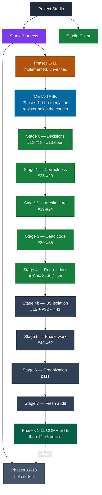

# Project Studio — project map

Orientation, not detail. Where things are; the things themselves are one click
away.

## What Project Studio is

A local-first environment for coding work driven by agents, built as separate
products designed to work together.

| Product | What it is | Where |
|---|---|---|
| **Studio Harness** | The runtime. Agents, permissions, sandboxing, policy, execution, storage, MCP. Everything with authority. | `STUDIO HARNESS/` |
| **Studio Client** | The Tauri desktop application over the Harness. | `STUDIO/` |

The Harness is the primary codebase. The retired Gateway does not shape its
architecture and never will again: the cloud was cancelled — the Worker in
`bd4d389`, the Harness's client for it in `45233d55` (2026-08-24) — and local
BYOK over Pi (ADR 0009) is the operational model source. The provider contract
still reserves the name "gateway" for a possible future *user-hosted* source.

## Where everything lives

```
Project Studio/                ONE git repository. No submodules.
│
├── documentation/             The only documentation root.
│   ├── README.md               The documentation system itself.
│   ├── project-map.md          This file.
│   ├── rules.md                Constraints that fail work outright.
│   ├── work/                   TEMPORARY. The active meta-task.
│   ├── architecture/           DURABLE. How the system is shaped.
│   ├── decisions/              DURABLE. ADRs; the index is the count.
│   ├── phases/                 DURABLE. What each phase delivered.
│   ├── audits/                 DURABLE. Read-only passes, dated.
│   └── archive/                Superseded, banner-marked.
│
├── STUDIO HARNESS/            THE RUNTIME. 250 tracked files. Primary codebase.
└── STUDIO/                    THE DESKTOP CLIENT. 129 tracked files.
```

Products are directories inside one repository, not separate repositories. Each
has its own `package.json` and `pnpm-workspace.yaml`, so they are independent
builds within one history — a normal monorepo. One branch, `main`; a commit can
span products.

## The path through, for a new session

1. `README.md` — how documentation works here.
2. `work/phases-1-11-remediation.md` — the single source of truth for current
   work. Every open issue, numbered and categorized.
3. `rules.md` — the constraints.

Everything else is reference, opened when one of those three names it.

## The current tree

Derived view — every fact here lives in a source document first. Statuses come
from what was observed by running the suite, not from checklists.

Work **branches**. Phases 1–11 did not each produce their own remediation;
together they produced one. That single trunk is where all current work happens,
and it may itself branch — a decision that turns out to need its own
investigation becomes a child of the issue that raised it, not a new top-level
task.



**Everything below Stage 0 is blocked on you.** The seven decisions are the only
thing standing between here and Stage 1.

### How a new branch appears

There is one rail. When something new is found, it does not become a parallel
task list — it becomes a numbered issue on the meta-task, in the stage its
dependencies put it in:

```
Stage N
   ↓
issue found  ─────►  new #N in the register, categorized
   ↓
needs a decision? ──►  Needs Decision, with options + recommendation
   ↓                      ↓
   └──────────────────  decision recorded as an ADR
                          ↓
                       Needs Implementation → Solved → verified → commit
```

A blocker is a **point on the rail**, not a detour off it. That is why there is
no `blockers/` folder.

## Current state, in one paragraph

Phases 1–11 are implemented and under remediation; none is verified. The two
defects that broke every agent submission are fixed and the suite is at 2
failures from 21. The modular-monolith gate was recorded closed but was
enforced by nothing — its tests asserted the violations rather than their
absence, and could not match a path on Windows at all; the storage half is now
closed and the tests bind. Seven decisions are open and block the rest. All of
it is enumerated in `work/phases-1-11-remediation.md`.

## Where a new fact goes

See `README.md` §9. Short version: anything we are currently doing goes in the
meta-task; anything durable goes in `architecture/`, `decisions/`, `phases/`, or
`rules.md`.
