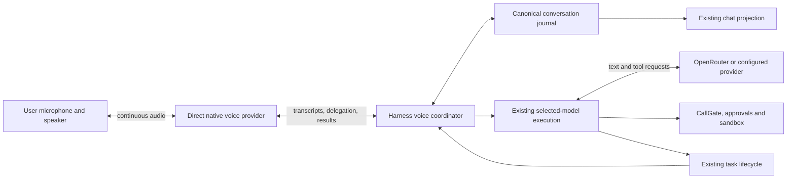

# Studio real-time voice: research and proposed architecture

Research date: 20 October 2026. Status: proposal for review; no implementation begun.

## Recommendation

Use a persistent native speech-to-speech session for conversation, connected to a Harness-owned coordinator that dispatches substantive work through Studio's existing selected-model execution path. Keep the existing chat model, tools, sandbox, approvals, task records, and canonical transcript authoritative. Introduce a separate voice provider/model selection, with an explicit distinction between conversational replies and answers produced by the selected chat model.

The strongest first evaluation candidate is **OpenAI `gpt-live-1` with client delegation**, compared against **Google `gemini-3.8-live` with non-blocking task tools**. These are current documented options, not assumptions based on the older Realtime and Gemini 2.5 APIs. GPT-Live explicitly accommodates an external agent harness; Google's direct Live API offers a potentially cheaper alternative. OpenAI Realtime 2.1/2.1-mini are additional candidates where explicit response/item control matters more than continuous full-duplex behavior.

This is a qualified endorsement of the dual-model idea. It works when the voice model conducts conversation and the Harness owns task interpretation, admission, execution, and results. It is a poor design when the voice model rewrites every instruction, waits synchronously for a second model on every turn, or claims completion before execution evidence exists.

**A universal two-second maximum is not achievable across arbitrary models and network conditions.** A healthy-session target of p95 <= 2 seconds for first relevant speech is a reasonable engineering objective to validate. Actual answers from an arbitrarily slow reasoning model cannot meet that bound. Fast acknowledgment, substantive answer, and task completion must be measured separately. No provider benchmark establishes Studio's end-to-end performance, and this research made no paid API calls or live latency measurements.

OpenAI documents independent voice/backend operation and external client delegation in its [GPT-Live overview](https://developers.openai.com/api/docs/guides/live). Google's [Live thinking guide](https://ai.google.dev/gemini-api/docs/live-api/thinking) describes its standard and background-reasoning variants. Neither is evidence that Studio will exactly reproduce ChatGPT Voice's implementation or behavior.

## What exists in Studio

The repository was inspected, including README, documentation rules and structure, the observability contract, relevant ADRs, client voice code, media adapters, conversation transport, storage ownership, and task routes. Source evidence takes precedence over stale orientation documents.

| Existing seam | Finding | Consequence |
|---|---|---|
| `STUDIO/src/features/voice/useVoiceMode.ts` | Real microphone level; simulated reply strings and artificial thinking timer; `END_SILENCE_MS = 1900` | Cannot be the real-time processing loop. Its endpoint delay alone nearly exhausts the budget. |
| `VoiceModeProvider.tsx` | `enter()` has no conversation argument; overlay receives open/close | Voice startup must acquire explicit conversation/project context, including detached windows. |
| `useMicInput.ts`, `segments.ts` | Dictation creates independently decodable files, cut at pauses | Reuse microphone lifecycle/UI knowledge, not file segmentation as the native audio stream. |
| ADR 0053 | Dictation uses 700 ms pauses or 12-second segments; streaming deliberately deferred | Dictation is useful functionality, but not the proposed voice architecture. |
| `speak.ts`, media driver types, OpenRouter media adapter | Completed base64 audio / completed transcript result contracts | Upstream streaming capability does not make these existing Studio paths stream. |
| `platform/harness/conversation.ts` | History snapshot plus offset-based updates; explicit queue/steer; separate stream cancellation and execution abort | Reuse transcript delivery and steering semantics. Audio needs a separate media transport. |
| `STUDIO HARNESS/src/storage/database.ts` | Flue owns canonical transcript, submissions, and run state; product DB is separate | A parallel authoritative voice transcript database would violate ownership. |
| Task routes and background-agent dispatch | Durable task index, cancellation intent, execution observations | Reuse actual task machinery; do not create a second voice agent runtime. |
| ADR 0054 | Studio-origin microphone permission in WebView2; OS privacy still applies | Validate duplex audio, echo cancellation, autoplay and Bluetooth separately on shipped WebView2. |

The observability contract already describes durable submission correlation, late-callback capture fencing, explicit steering during model execution, and cancellation requests distinct from confirmed termination. Voice must fit these rules from its first effectful boundary.

The canonical journal write seam is a **design investigation still required**: normal prompt submission triggers execution. Recording a voice-model-only reply or utterance must not accidentally invoke the primary model. The existing reader and task routes do not prove that a safe application-owned external-message append path already exists. Verify the pinned Flue API/patch before deciding how to integrate these records. Do not write directly to Flue's SQLite tables.

## Provider capabilities: audio files versus interactive sessions

These are separate capabilities:

1. Audio-file input: a request contains a recording; the model may return text.
2. Streaming output: response text/audio arrives incrementally after submission.
3. Streaming audio input: new microphone frames enter an ongoing connection.
4. Interactive duplex session: input continues during output, with interruption, turn-taking, history and task events.
5. Model-level full duplex: overlapping speech and backchannels are part of conversational behavior, beyond merely keeping a microphone open during a response.

Only the last two directly address the intended product experience. A WebSocket transport alone does not establish either.

### OpenRouter

Verified public interfaces include audio input/output in Chat Completions, a speech endpoint, and a transcription endpoint. Chat audio input is base64 content; output audio can stream through `delta.audio` with accompanying transcript text. This is useful, but it does not establish an OpenAI Realtime- or Gemini Live-compatible persistent duplex session. Sources: [audio guide](https://openrouter.ai/docs/guides/overview/multimodal/audio), [audio API announcement](https://openrouter.ai/blog/announcing-audio-apis/), [TTS tutorial](https://openrouter.ai/blog/tutorials/text-to-speech/).

I did not find a documented public OpenRouter duplex voice-session API in the reviewed documentation. This is a finding about published support, not proof that no private or future integration exists. Model names, audio modality filters, “streaming,” or a realtime transcription model description are insufficient capability evidence.

**Planning consequence:** use a direct voice-provider connection and retain OpenRouter for the selected backend model. An OpenRouter key should not be assumed usable against OpenAI or Google directly. An OpenRouter-only setup can offer a cascade, with a qualified latency expectation; it cannot inherit an undocumented Live transport.

### Native and managed candidates

| Provider / candidate | Verified relevant capability | Studio assessment |
|---|---|---|
| OpenAI GPT-Live, `gpt-live-1` | Full-duplex speech; independent backend; client delegation; WebRTC/WebSocket; transcripts | Best architectural fit to evaluate first. Dedicated direct integration. |
| OpenAI Realtime, `gpt-realtime-2.1`, `gpt-realtime-2.1-mini` | Streaming speech-to-speech, function calls, configurable reasoning; WebRTC/WebSocket/SIP | Strong alternative with item/response controls. Keep reasoning low where supported and evaluate instruction fidelity. |
| Google Live, `gemini-3.8-live` | Native bidirectional audio; standard model supports blocking/non-blocking tools | Main cost-oriented challenger. PCM/WebSocket integration and task scheduling need care. |
| Google `gemini-3.8-live-extended-thinking` | Background reasoning, non-blocking tools and separate interaction status | Valuable if voice itself must reason; potentially redundant when Studio's selected model performs that work. |
| Google older Live models | `gemini-3.1-flash-live-preview` and 2.5 native audio remain in reviewed docs | Do not assume identical behavior: 3.1's documented async-function limitation matters. |
| xAI `grok-voice-3.0` / `grok-voice-latest` | Bidirectional audio/text WebSocket; tools and ephemeral authentication | Viable additional native candidate. No reviewed evidence establishes equivalent asynchronous delegation behavior; test before choosing. |
| Amazon Nova 2 Sonic, `amazon.nova-2-sonic-v1:0` | Native bidirectional speech stream and conversational integration | Viable for AWS users; adds AWS credentials, regional deployment and streaming protocol work. |
| Deepgram Voice Agent | Managed speech/LLM/speech orchestration, custom LLM endpoint | Reduces audio orchestration work but still waits for the configured LLM. A cloud service cannot call Studio's localhost Harness directly. |
| NVIDIA PersonaPlex / Moshi family | Open-weight full-duplex conversational research model | Future local/private option; hardware, tool integration, language quality and distribution are separate substantial work. |

Capability references: [GPT-Live model](https://developers.openai.com/api/docs/models/gpt-live-1), [Realtime 2.1](https://developers.openai.com/api/docs/models/gpt-realtime-2.1), [Realtime 2.1 mini](https://developers.openai.com/api/docs/models/gpt-realtime-2.1-mini), [Google tool support](https://ai.google.dev/gemini-api/docs/live-api/tools), [xAI speech-to-speech](https://docs.x.ai/developers/model-capabilities/audio/speech-to-speech), [Nova integrations](https://docs.aws.amazon.com/nova/latest/nova2-userguide/sonic-integrations.html), [Deepgram message flow](https://developers.deepgram.com/docs/voice-agent-message-flow), [PersonaPlex research](https://research.nvidia.com/labs/adlr/personaplex/).

Google's documentation currently mixes examples for 3.8 with a support table for 3.1/2.5. Its thinking guide explicitly documents 3.8 asynchronous tools. Resolve version-specific behavior in a contract test rather than generalizing across the family.

Provider latency statements require care. AWS publishes a sub-700 ms end-of-speech-to-first-audio-token figure in an [application guidance example](https://docs.aws.amazon.com/guidance/latest/agentic-vehicle-experience-on-aws/nova-sonic-voice.html). xAI advertises sub-second voice latency in its [overview](https://docs.x.ai/developers/model-capabilities/audio/voice). Neither measures Studio's device playback, geography, queueing, or p95, and neither is a hard end-to-end guarantee.

## Architecture comparison

All ranges below are **engineering estimates for planning, not measured results or provider SLAs**. They assume an established connection, working microphone, a short ordinary utterance, bounded context, no required external lookup, and roughly 40-150 ms provider RTT. Degraded paths assume heavier load, longer RTT, buffering or moderate reasoning. Bangladesh/other distant-client RTT must be measured, not inferred from this assumption. Cold startup is separate.

| Architecture and complete critical path | Best case first audible speech | Healthy expected range | Degraded example; absolute worst | Compatibility and principal trade-off |
|---|---:|---:|---|---|
| Batch recording -> STT -> full LLM answer -> complete TTS -> playback | 2-4 s | 5-15 s | 15-30+ s; unbounded/failure | Any text model; simple, poor fit for conversational timing |
| Streaming STT -> selected LLM tokens -> phrase-streaming TTS -> playback | 0.6-1.2 s | 1.2-2.8 s with a tuned fast model | 3-8+ s; unbounded/failure | Any text model; preserves exact model authorship, loses speech prosody and needs custom orchestration |
| Same cascade with arbitrary reasoning model | 1-2 s on an easy fast turn | 2-8+ s, highly model dependent | 10-30+ s or much longer | Full model choice; fails a consistent two-second answer objective |
| Native audio model handles conversation and tools itself | 0.3-0.8 s | 0.7-1.8 s for ordinary replies | 2-5+ s; unbounded/failure | Natural audio; primary model choice no longer governs those answers; tools still take time |
| Native audio conversation + asynchronous Studio-selected backend | 0.3-0.8 s | 0.7-1.8 s for direct replies or grounded acknowledgment | 2-5+ s; backend answer may take seconds/minutes | Best fit for responsive conversation plus arbitrary task model; hardest context and journal integration |
| Fast text conversational model + streaming STT/TTS + asynchronous backend | 0.6-1.2 s | 1.2-2.8 s for frontend speech | 3-8+ s; backend independent | Portable frontend; more audio components, usually less natural than native audio |
| Managed voice service + custom LLM | 0.5-1.2 s | 1-3 s with fast LLM | 3-10+ s or slow-model wait | Less media work, more external orchestration/data exposure and often extra cost |

These are overlapping ranges, not a ranking established by tests. For cascades, sentence length, prompt size, provider queueing and TTS text buffering can move the result substantially. A good cascade can outperform a poorly configured native session.

Every architecture can stop local playback. Native providers supply more conversation-aware cancellation; a cascade must implement VAD, inference cancellation, TTS clearing, playback clearing and heard-context correction itself. Full-duplex naturalness is not equivalent across these choices.

### Why an optimized cascade is not inherently 10-20 seconds

Streaming STT works while the person speaks; most transcription need not happen after the final word. LLM output and TTS should overlap after a short safe phrase. Never wait for the whole answer or an arbitrarily long sentence.

Approximate residual costs after the final spoken sample:

| Component | Tuned planning budget | Notes |
|---|---:|---|
| Capture tail, framing, resampling | 10-40 ms | Most capture ran before the latency clock starts |
| Endpointing / turn decision | 200-500 ms | Longer deliberate pauses may need 600-1,200+ ms |
| Final STT residual | 50-200 ms | Assumes a live recognizer, not file upload |
| Cumulative network transit between stages | 120-350 ms | Excludes provider compute; do not add RTT twice |
| LLM queue/prefill to first usable text, compute portion | 150-600 ms | Fast model/short context assumption; arbitrary reasoning has no such bound |
| Accumulate speakable phrase | 50-200 ms | Token throughput matters here |
| TTS initial compute | 80-250 ms | Depends on model, text, voice, normalization |
| Playback buffer/device start | 40-120 ms | Bluetooth can exceed this |
| Total illustrative critical path | 700-2,260 ms | Some stages overlap; correlated tails make a p95 harder than a median |

ElevenLabs documents roughly 75 ms inference for Flash v2.5, **excluding application and network latency**. That cannot be used as end-to-end TTS or voice latency. See its [latency explanation](https://elevenlabs.io/docs/eleven-api/concepts/latency) and [model documentation](https://elevenlabs.io/docs/overview/models).

Native audio removes explicit STT -> LLM and text -> TTS handoffs. A nominal 1.05-second budget might be: 30 ms framing + 300 ms turn decision + 150 ms transit + 450 ms first-audio processing + 120 ms playback. Some native models process continuously rather than exposing these exact stages; this is an accounting model, not their internal implementation.

A separate serial intent classifier adds another first-response wait. Prefer native delegation decisions and deterministic application checks; put expensive interpretation on the backend path. A task enqueue should be local and short, but waiting for a usable transcript or resolving ambiguity can take longer. Do not put that wait on unrelated conversational speech.

### What two seconds should mean

Record at least these separate metrics:

- End-of-utterance to first **audible, relevant** response, including endpointing.
- End-of-utterance to first substantive answer; label acknowledgments separately.
- End-of-utterance to confirmed task admission, and to terminal task result.
- Backend result ready to first spoken result.
- Interruption onset to acoustic silence, plus false-interruption rate.
- Complete response duration and playback underruns.
- Voice startup time, recovery time, and unsuccessful turns.

The last acoustic speech sample is the reference point, not the later VAD event. Offline annotated recordings are needed to measure endpointing honestly. A “thinking” sound is not a spoken answer. A ten-second utterance is not ten seconds of response latency. Forty spoken words at 160 words/minute take roughly 15 seconds to finish even if speech starts in one second.

Proposed acceptance objectives: warm ordinary turns p50 <= 1 second and p95 <= 2 seconds; interruption-to-silence p95 <= 200 ms on supported wired/local-speaker devices. These are proposed release gates, not claims of current ability. Report tails, failures and Bluetooth separately. Never sell the healthy-path objective as an absolute maximum.

## Proposed cooperation model

This is a proposed responsibility split, not new components already present in source.

**Client:** microphone permission/lifecycle, audio transport/playback, local stop, captions, and the chat UI. Full provider keys stay in the Harness/credential store. A provider-issued ephemeral capability, if used in the browser, is not Studio's owner bearer and must remain short-lived and scoped.

**Voice model:** ordinary conversation, simple questions within its supplied context, clarification, interruption-aware speech, and reporting evidence-backed progress. It does not secretly impersonate the primary model. The setting should say which model handles spoken conversation and which handles tasks.

**Harness coordinator:** stable conversation binding, transcript assembly, source references, task/revision routing, durable admission, result selection, deadlines and reconnect policy. Provider-specific code remains under `gateway/`; database access remains under `storage/`.

**Primary model:** exact selected chat model for substantial reasoning and actions, with existing tool and agent controls. No promise that every selectable model supports every tool workflow: preserve current capability limitations.

### Task dispatch without losing instructions

Use a trusted envelope assembled by the Harness containing references to original user transcript spans, conversation history revision/offset, relevant attachments, existing task identity, and requested operation: new work, correction, status, or cancellation. Model-generated interpretation is a labeled hypothesis, never a replacement for source text.

Preserve names, numbers, negation, paths, URLs and ordering verbatim in the source transcript. ASR is still imperfect; verbatim transcript does not mean verbatim speech. For unclear task-critical words, ask a targeted clarification or allow text editing. Avoid a punctuation/improvement model that silently rewrites instructions.

Route with a conservative policy: social chat can be answered directly; anything requiring workspace state, tools, current external facts or substantial reasoning goes to the backend. Uncertainty can produce a short clarification. Do not require a classifier call before every reply. A source-referenced request is more valuable than “the voice model is good at intent.”

For GPT-Live specifically, `session.delegation.created` carries an ID, timestamp and target, **not the user's task text**. Studio must construct that request from its transcript and task state. Repeated provider events must not start repeated work. See [client delegation](https://developers.openai.com/api/docs/guides/live-delegation).

Task admission should happen before saying “I started.” Before admission, “I can check that” is more accurate. While work runs, allow conversation and corrections. Return verified status, blockers, evidence and artifacts; do not have the voice model guess at completion. Keep detailed backend output visible; a spoken summary links to it and does not replace it.

### Revisions and cancellation

Audio interruption, changed intent, and cancellation of work are distinct:

- “Actually, explain that more simply” stops/replaces speech; it need not stop a file-writing task.
- “Use the other branch instead” steers the existing task at a safe boundary or requests cancellation/restart after state reconciliation.
- “Stop the task” uses the existing task cancellation path; requested is not confirmed.
- Closing voice mode stops recording/playback and releases the provider session; ongoing admitted tasks follow normal Studio lifecycle.

Bind every result to the task revision that produced it. If an earlier result arrives after a correction, retain it as execution evidence but do not present it as the current answer. Never start concurrent conflicting workspace edits merely because the voice model requests parallel work.

The existing explicit-steering implementation cancels a running model request and joins the correction through durable input; steering during tools waits for the tool boundary. Voice should reuse that behavior rather than promising arbitrary rollback mid-tool.

## Continuous audio and interruption

Keep input active while output plays, with browser/WebView acoustic echo cancellation, noise suppression and appropriate gain handling. An RMS waveform is not a robust speech detector. Test speakers, headsets, Bluetooth, fan noise, music, accents, code-switching and soft speech. Double processing can degrade speech, so validate actual capture settings rather than stacking every filter.

Turn-taking needs both speech detection and an end-of-turn policy. A 200-500 ms silence target is useful for simple completed sentences; it will interrupt a person thinking mid-sentence unless semantic context or adaptive endpointing helps. OpenAI Realtime documents server and semantic VAD with adjustable eagerness in its [VAD guide](https://developers.openai.com/api/docs/guides/realtime-vad). Do not assume those exact settings apply to GPT-Live.

On interruption, immediately stop or duck local scheduled audio, invalidate queued chunks from the old response generation, and send provider-specific cancellation/clear events. Track what actually played. An audio generation ID/epoch prevents late packets from restarting obsolete speech. Keep a small bounded jitter buffer; larger buffering helps continuity but delays both initial playback and stopping. AudioWorklet/streaming PCM is appropriate for a raw-audio fallback; repeated MediaRecorder files and whole-response base64 decoding are not.

OpenAI Realtime handles unplayed-output truncation on WebRTC/SIP; WebSocket playback requires the client to stop playback and send item truncation. Its documentation explicitly warns that exact truncated text cannot simply be recovered from audio truncation. See [Realtime conversations](https://developers.openai.com/api/docs/guides/realtime-conversations). Implement each provider's own lifecycle rather than carrying these event names into Live or Gemini.

For Google, interrupted output requires clearing local audio; session handling must also account for reconnection, resumption and context compression. Google documents session-duration limits and extension techniques in [capabilities](https://ai.google.dev/gemini-api/docs/live-api/capabilities) and [session management](https://ai.google.dev/gemini-api/docs/live-api/session-management). Test the exact chosen model and account limits.

For true full duplex, a quiet “yes” may be a backchannel, not a request to cancel. Avoid treating every detected sound as a hard reset. Provide a reliable visible stop control and an optional push-to-talk fallback while keeping continuous conversation the default.

## Chat history and synchronization

The product needs **one authoritative history with several projections**, not synchronized independent model memories. Provider session context is a cache of selected history and acoustic state; it is never Studio's durable source of truth.

Use these conceptual states in the future contract:

| Record | Lifecycle and meaning |
|---|---|
| Input transcript fragment | Provisional caption, source timestamps/revision; may arrive late or be corrected |
| User utterance | Stable application identity after grouping; finalization policy is explicit, not inferred from a network gap |
| Assistant speech | Generated text plus playback state: played, interrupted, unplayed or unknown |
| Backend work | Existing submission/task/tool events, with evidence and terminal status |
| Spoken result | Voice rendering of a linked backend result; preserves actual model provenance |

The exact journal event representation requires the Flue seam investigation above. Add meaningful external-message support there if absent, rather than pretending a projection or product index is the transcript.

Important GPT-Live constraint: its input/output transcript deltas have timestamps but no item ID or turn-completed event. They may overlap and arrive unevenly. Keep speaker streams independently, preserve received spacing/repetition, and group for display using explicit application rules. Do not mark an utterance final because no packet arrived for 300 ms. A useful grouping policy combines local speech activity, provider timing and a bounded settling period, with versioned corrections when later evidence arrives. The exact settling period is a measurement decision. Reference: [GPT-Live session management](https://developers.openai.com/api/docs/guides/live-conversations).

For critical dispatch, wait for a sufficiently stable utterance or clarify. Keep normal voice interaction independent of that wait. Test delegation-before-transcript races; a delegation timestamp does not prove all earlier fragments have arrived. If GPT-Live cannot supply sufficiently reliable source boundaries, prefer Realtime's itemized events or a supplemental streaming recognizer for task-critical transcription. That extra recognizer costs money and introduces disagreement; it should be conditional on evidence, not the starting design.

Persist each user utterance once. Replaying captions after reconnect must not submit the same prompt again. Use existing IDs for conversation/submission/task; give genuinely new voice sessions and connections distinct identities; map opaque provider IDs rather than replacing them. Keep a durable admission record before promising exactly-once behavior. The current source contains both older “no deduplication” comments and newer durable receipt handling; audit actual admission semantics rather than relying on either comment alone.

On startup, read the canonical history and offset, build a bounded context view, include unresolved tasks and exact relevant constraints, and start the voice session. GPT-Live accepts prior text messages at startup; append task/context changes as supported. On exit, flush available captions, mark uncertain tails honestly, and release media. Re-enter from canonical history rather than assuming an old provider connection survives. Keep large tool output and code in backend history, with references and concise context for voice.

For interrupted replies, preserve generated text for review if useful but clearly identify unplayed/unknown delivery. Do not place unspoken promises into future conversational context as though the user heard them. Exact word-level playback alignment is not available uniformly; store measured sample position and label any text boundary estimate.

Use the existing history-snapshot + offset-updates path to rebuild client state. No automatic task resubmission after broken audio, missing acknowledgment, reconnect, provider failover or session replacement. Reconcile against durable task state first.

## Transport and local-first constraints

Prefer direct WebRTC client-to-provider audio for OpenAI, with session creation and a server-side control connection owned by the local Harness. It avoids carrying all media through JSON IPC/SSE and delegates jitter/codec handling to a media transport. Server-side control is documented in [OpenAI's sideband guide](https://developers.openai.com/api/docs/guides/voice-server-controls).

However, evaluate whether the selected provider's ephemeral client capability allows control events that could spoof backend-result context. Execution must remain Harness-authorized, and authoritative delegation/result handling must use the trusted server connection. A connected browser is not a new tool authority. If the provider cannot enforce the desired control separation, choose a Harness-mediated stream instead.

For Google or a WebSocket-only path, relay ordered audio/control through a bounded admitted channel to the Harness and then upstream. Do not put long-lived credentials in browser WebSocket URLs. A native bridge or admitted WebSocket may be needed; the current request/response and SSE transports do not establish this capability. Keep media and durable chat/control streams separate so backpressure from one cannot freeze the other.

A loopback Harness is the trusted application server; no mandatory Studio cloud relay is needed. Remote-browser clients must use the existing paired/admitted origin and a secure microphone context. An external managed agent service cannot invoke local tools through a custom localhost LLM endpoint; exposing such an endpoint would be a separate deployment decision, not a default requirement.

Avoid LiveKit/Pipecat as mandatory infrastructure for the initial desktop integration. They can help with media rooms, telephony, transport, VAD and plugin orchestration, but they do not eliminate model latency. Introduce a framework only if measured integration needs justify the dependencies and operation model; this repository currently prohibits casually adding dependencies.

## Model selection and costs

### Candidate roles

| Candidate | Role and reason to test | Main caveat |
|---|---|---|
| `gpt-live-1` direct | Initial conversational reference implementation; explicit external client delegation | Duration billing during silence/backend work; transcript grouping is application-owned |
| `gemini-3.8-live` direct | Cost challenger; native audio with non-blocking backend task tools | Validate model-specific async behavior, transcript quality and context billing |
| `gpt-realtime-2.1-mini` direct | Lower-cost itemized speech session | Evaluate exact instructions, task classification and names/numbers; no quality assumption from “mini” |
| `gpt-realtime-2.1` direct | Quality comparator with explicit response lifecycle | More expensive audio; increasing reasoning increases latency |
| Gemini 3.1 Flash-Lite via OpenRouter | Minimal-thinking text frontend for a cascade | Audio input capability is not native audio output or Live transport |
| GPT-4.1 mini via OpenRouter | Non-reasoning text baseline for a cascade | Older model; evaluate current task reliability, not just low price |
| Llama 3.3 70B Instruct via OpenRouter | Cheap non-reasoning/provider-diverse baseline | Provider variance and language/task performance; older knowledge |

OpenRouter lists [Flash-Lite](https://openrouter.ai/google/gemini-3.1-flash-lite/api) and [Llama 3.3](https://openrouter.ai/meta-llama/llama-3.3-70b-instruct?tab=parameters); OpenAI documents [GPT-4.1 mini](https://developers.openai.com/api/docs/models/gpt-4.1-mini). These are concrete baselines, not a claim that the oldest/cheapest models are globally best. A native voice architecture does not need another lightweight text model on every turn.

Do not rank candidates by unmeasured tokens/second. At 100 tokens/second, a 12-token phrase takes about 120 ms after generation starts; at 40 tokens/second, about 300 ms. Either can still lose to a model with lower first-token latency. Test time to first usable phrase, p95 provider queueing, transcript quality, tool fidelity, and cold/long-context behavior. Prefer supported minimal/no reasoning for the conversational path; do not assume every model can disable reasoning.

### Verified rate examples in USD

Rates are a research snapshot, excluding tax, tools, backend work and historical-context costs unless stated.

| Service | Published unit rates | Interpretation |
|---|---|---|
| GPT-Live 1 | $0.05 / active session minute, billed per second | Ten active minutes = $0.50, plus backend costs |
| Realtime 2.1 | Audio $32 input / $64 output per million tokens; text $4 / $24 | Audio time and accumulated context matter |
| Realtime 2.1 mini | Audio $10 / $20 per million; text $0.60 / $2.40 | Lower raw media cost; assess quality first |
| Gemini 3.8 Live family | Audio $3 / $12 per million; published approximate $0.005 input / $0.018 output per audio minute; text $0.75 / $4.50 per million | Fresh-media estimate is not the whole multi-turn bill |
| Deepgram Flux English streaming STT | Promotional $0.0065 / minute; regular displayed $0.0077 | Streaming connection/audio usage needs accounting |
| Deepgram Aura-2 TTS | $0.030 / 1,000 characters | Speech length determines output cost |
| Deepgram Voice Agent | Standard $0.075/min; BYO LLM $0.059/min | BYO model charges are additional |
| xAI voice | Overview advertises starting at $0.05/min | Confirm rate for pinned voice model/account before comparison |
| Flash-Lite via OpenRouter | $0.25 input / $1.50 output per million text tokens | Minimal thinking and provider choice affect usage |
| GPT-4.1 mini | $0.40 / $1.60 per million text tokens | Useful explicit non-reasoning baseline |
| Llama 3.3 via OpenRouter | Listed from $0.10 / $0.32 per million text tokens | Routing and chosen provider can change price |

Pricing sources: [GPT-Live](https://developers.openai.com/api/docs/models/gpt-live-1), [Realtime 2.1](https://developers.openai.com/api/docs/models/gpt-realtime-2.1), [Realtime mini](https://developers.openai.com/api/docs/models/gpt-realtime-2.1-mini), [Google pricing](https://ai.google.dev/gemini-api/docs/pricing), [Deepgram pricing](https://deepgram.com/pricing), [xAI overview](https://docs.x.ai/developers/model-capabilities/audio/voice), and the text model pages above. AWS rates are regional/model specific; no verified comparable Nova rate is asserted here.

### Comparable session arithmetic

Assume 10 minutes connected, 4 minutes user speech, 4 minutes assistant speech, 2 minutes silence; backend tasks are additional.

- GPT-Live: **$0.50** in voice duration. Silence and backend wait still accrue duration charges. Muting is not closing. WebRTC initialization bills 15 seconds credited against a running session; failed/abandoned starts need separate accounting.
- Realtime mini: about **$0.12 for fresh audio only**, using the documented 10 input and 20 output audio tokens/second: 2,400 x $10/M + 4,800 x $20/M. Realtime 2.1 is about **$0.384** on the same arithmetic. These are not total-session quotes.
- Gemini: approximately **$0.092 for fresh audio only**, using the pricing page's per-minute equivalents: 4 x $0.005 + 4 x $0.018. Historical audio reprocessing/context and text/thinking can materially raise the total.
- Flux STT + Aura-2 cascade: **about $0.173 before LLM** if billed for 10 minutes of stream and 3,600 synthesized characters: $0.065 + $0.108. Different silence accounting, language and speaking rate change this.
- Deepgram managed Standard: **$0.75** for 10 minutes; BYO LLM **$0.59 plus that LLM's bill**.

OpenAI's [cost guide](https://developers.openai.com/api/docs/guides/voice-latency-cost) documents duration accounting, audio token rates, separate transcription charges and historical-context/caching behavior. Google's [best practices](https://ai.google.dev/gemini-api/docs/live-api/best-practices) warns that retained native-audio context can be rebilled across turns. Do not market the fresh-audio calculations as flat session rates.

For a text frontend with 20 turns, 4,000 input tokens each and 100 output tokens each, uncached model-only cost is approximately $0.023 for Flash-Lite, $0.0352 for GPT-4.1 mini, or $0.00864 at the listed Llama rate. This excludes reasoning, tools, audio and increased context. The voice frontend is frequently the larger cost; cutting a few text tokens will not compensate for long idle sessions.

Cost controls: short spoken answers, bounded voice context, stable prompts/cache use where supported, explicit session close, inactivity policy visible to the user, usage counters, and backend invocation only when needed. Avoid repeated filler speech. Do not rotate sessions solely to chase cost without considering startup delay, lost acoustic context and duplicate-work risk.

### User configuration

Offer a tested default voice profile, an advanced provider/model/voice picker, and the current primary chat model as the task model. Show capability limitations honestly. Derive support from verified session protocol capabilities, not `audioInput` / `speechGeneration` flags alone.

Expose an optional “use selected model for every answer” mode implemented with a streaming cascade, with a clear model-dependent response time. It is incompatible with a universal two-second answer guarantee. Do not silently replace the selected chat model or switch providers mid-session. Default selection should use an already configured supported connection; otherwise explain the required direct voice connection.

## Alternatives and optimizations worth retaining

**Speculative generation:** streaming STT can signal a probable end before the final decision. Deepgram Flux exposes `EagerEndOfTurn` and `TurnResumed`; the latter invalidates speculation. Its [guide](https://developers.deepgram.com/docs/flux/voice-agent-eager-eot) documents this pattern. Start cancellable inference early, but keep audio buffered until safe and forbid side effects before stable task admission. Wasted tokens and false starts are the trade-off. Add after a measured baseline, not before correctness.

**Dynamic architecture choice:** select a native or cascade profile at session startup. Changing automatically within a live utterance risks voice changes, duplicate transcripts and work. Switch only at explicit safe boundaries and restore canonical context.

**Single native agent:** simpler if users accept that the native model handles all reasoning. It is legitimate for a separate product profile, but it does not preserve arbitrary selected-model authorship or solve long tool waits by itself.

**Text-controlled exact narration:** when a final result must preserve exact wording or numbers, use streaming TTS of the backend's approved speech text. This reduces paraphrase risk but adds a second rendering path and possible voice inconsistency. Reserve it for cases where native summaries fail fidelity tests.

**Local voice inference:** PersonaPlex offers genuine full-duplex research capability, not merely local Whisper plus TTS. Its 7B model and audio codecs still need compatible hardware, runtime, licensing review and task integration. It is a later provider integration, not a prerequisite for the first desktop release.

## Risks and release evidence

| Risk | Mitigation and required evidence |
|---|---|
| Voice model changes the request | Source-linked transcript, exact constraints, task-critical clarification; compare delegated task success against direct text baseline |
| Incorrect conversational/task routing | Mixed-intent evaluation set; measure missed work, unnecessary delegation and clarification burden |
| Missing/late transcript | Explicit assembly policy; test delegation-before-transcript and session loss; do not invent unheard words |
| Two models diverge | Canonical history revision, bounded context views, revision-bound task results, visible model provenance |
| Reconnect repeats an effect | Durable admission reconciliation, no transport-driven resubmission, duplicate/unknown-outcome tests |
| Assistant claims success early | Task-status vocabulary supplied by Harness; verify spoken result against terminal execution evidence |
| Barge-in leaves stale audio | Local generation fence, queue clear, provider cancellation, acoustic stop-time tests |
| Echo causes self-interruption | Actual WebView2 speaker/headset tests and AEC tuning; track false triggers |
| Long-session cost or memory growth | 10/30/60-minute usage tests, context policy, visible idle close and spend accounting |
| Native provider outage | Honest session failure; explicit reconnect/fallback with task reconciliation |
| Permissions bypass | All actual tool effects retain CallGate, sandbox and existing agent scopes; voice intent is never authorization |
| Privacy leakage | Product transcript versus diagnostics kept distinct; no raw-audio retention by default; gated bounded content, no credentials in observations |

Record stable stages such as session opening, input activity, turn decision, first audio, playback started, interruption requested, task admitted and task settled. Use central Studio ID factories; retain external session/item/delegation IDs as opaque mappings. Propagate execution parents with `observeOperation`; bind callbacks through `createObservationWriter`; use `OperationObservation` for detached work. Sample/coalesce audio health instead of recording every frame. Capture gaps and unsupported playback evidence must remain explicit.

Do not enable diagnostics or retain audio because the build is debug. Transcripts required for chat continuity are product records with their own deletion behavior, not an excuse for diagnostic collection. No external Inspector implementation belongs in this work. Before release, update the observability contract/coverage inventory and active progress tracker for each new boundary.

## Proposed roadmap, without beginning implementation

1. **Approve semantics and performance gates.** Decide model provenance, whether the voice model may answer casual questions, transcript retention, interrupted-message display, task correction/cancellation behavior, and the distinction between a conversational target and an answer guarantee. Define a representative evaluation corpus before choosing by demos.
2. **Resolve the canonical journal seam.** Inspect the pinned Flue write/append and admission interfaces. Establish a supported way to persist externally produced utterances/replies without triggering duplicate model runs, and determine what durable deduplication already guarantees. This is the highest architecture dependency.
3. **Run isolated provider evaluations after implementation is authorized.** Compare GPT-Live client delegation, Gemini 3.8 non-blocking tools, and an itemized Realtime candidate. Use fake/local deterministic task backends first. Measure latency, task-source reconstruction, interruptions, usage and language quality from actual devices/geographies. No production task tools needed for this comparison.
4. **Build one vertical slice with the winning provider.** Existing-chat binding, microphone, streamed audio/captions, canonical journal projection, history seeding and a harmless task-status request. Instrument every new boundary and run privacy/failure controls from the beginning. No automatic provider failover.
5. **Connect the existing selected-model runtime.** Admit exact source-linked tasks, reuse approvals/tools/background execution, expose progress and artifacts, and support explicit steering/cancellation. Test a fast text model and a deliberately slow reasoning model; responsiveness must survive the latter without mislabeling acknowledgments as answers.
6. **Harden lifecycle and delivery.** Loss, reconnect, duplicate events, late results, capture clear/replacement, voice/text switching, detached windows, remote paired browser, OS microphone denial, device change, sleep/wake, long sessions and interruption during tools.
7. **Add a second native provider or the streaming cascade only when justified.** A second implementation makes a shared session contract concrete. Avoid a speculative universal adapter. Retain existing dictation/read-aloud behavior.
8. **Release against measured gates.** Report p50/p95/p99, unsuccessful turns, substantive-answer latency, routing/task quality and 10/30/60-minute cost. Run Harness and client full checks sequentially; native changes additionally require appropriate isolated-state cargo checks. A focused green suite does not complete Studio's observability readiness gate.

The provider choice remains provisional until stages 2-3 establish transcript fidelity, a viable canonical-journal path and actual tail latency. The architecture recommendation is firm enough to guide those evaluations: a native conversational session with asynchronous Harness-owned work offers the strongest practical route to continuous, interruptible voice while preserving OpenRouter model choice for substantive tasks.

## Scope of this research

Only this report was added. Application source, dependencies, settings, existing documentation and unrelated working-tree edits were not changed. No implementation, benchmarks, API usage charges, commits or test-suite runs were performed. Numerical response ranges are planning estimates; pricing calculations are explicitly scoped examples. Actual account/model availability, regional latency, transcript fidelity and long-session bills remain evaluation requirements.
